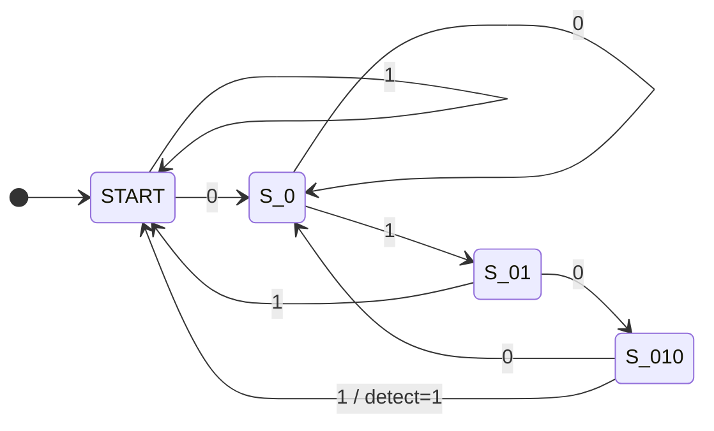
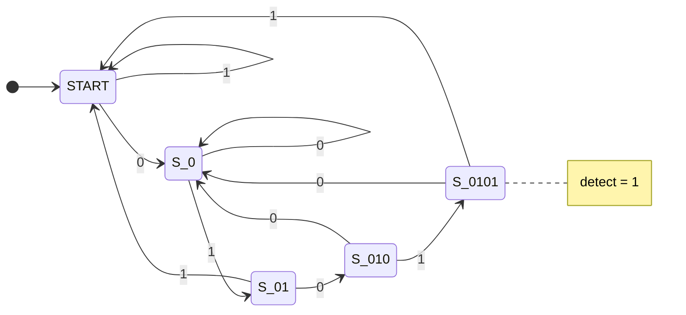

# pattern_detection — 0101 패턴 검출기 (Mealy vs Moore)

> 📅 2026-07-27 · Vivado 2020.2 · 과제 7 · 시뮬레이션

직렬 1bit 입력에서 **겹치지 않는(non-overlap) `0101` 패턴**을 찾는 FSM을 **Mealy**와 **Moore** 두 방식으로 설계하고,
같은 입력 `001010101`을 넣어 상태 수와 검출 타이밍 차이를 비교한 프로젝트.

## 파일 구조

```
pattern_detection/
├── src/pattern_detection.v     # pattern_detection_mealy, pattern_detection_moore
└── tb/tb_pattern_detector.v    # 두 FSM에 같은 입력을 동시에 넣어 비교
```

---

## 설계

### Mealy — 상태 4개 (2bit)



```verilog
assign o_detect = ((c_state == S_010) && (i_pattern == 1)) ? 1 : 0;   // 상태 + 현재 입력
```

### Moore — 상태 5개 (3bit)



```verilog
assign o_detect = (c_state == S_0101) ? 1 : 0;   // 현재 상태만
```

- non-overlap이라 패턴을 찾은 뒤에는 앞 비트를 재사용하지 않고 처음부터(START / S_0) 다시 셈
- next state 로직은 `always @(*)` 시작에서 `n_state = START;`로 초기값을 줘 full case 처리

## Simulation

```verilog
reg [8:0] target = 9'b001010101;

for (i = 8; i >= 0; i = i - 1) begin   // MSB부터 1bit씩 입력
    i_pattern = target[i];
    #10;
end
```

입력 `0 0 1 0 1 0 1 0 1` → `0101`이 겹치지 않게 **2번** 검출

| | 검출 시점 |
|---|---|
| Mealy | 4번째 비트(`1`)가 **들어오는 순간** 바로 1 (같은 clk 구간) |
| Moore | 그 다음 **clk posedge에 상태가 S_0101로 바뀐 뒤** 1 → 1clk 늦음 |

## Mealy vs Moore 정리

| | Mealy | Moore |
|---|---|---|
| 출력 결정 | 현재 상태 + **현재 입력** | **현재 상태**만 |
| 상태 수 | 4개 (2bit) | 5개 (3bit) — 완성 상태가 별도로 필요 |
| 반응 속도 | 입력 즉시 | 1clk 늦음 |
| 출력 안정성 | 입력 glitch가 출력에 그대로 전달될 수 있음 | clk에 동기되어 안정적 |

---

## 배운 내용

- Mealy의 출력은 조합 출력이라 입력이 바뀌면 출력도 바로 바뀜 → 필요하면 출력에 F/F를 달아 순차 출력으로 만듦 (그러면 Moore처럼 1clk 늦어짐)
- 상태 1개(1bit) 차이는 최적화 관점에서 미미하지만, **출력 타이밍 차이**는 설계 시 꼭 고려해야 함
- 테스트벤치에서 두 DUT에 같은 stimulus를 동시에 넣으면 차이를 한 파형에서 비교하기 좋음
