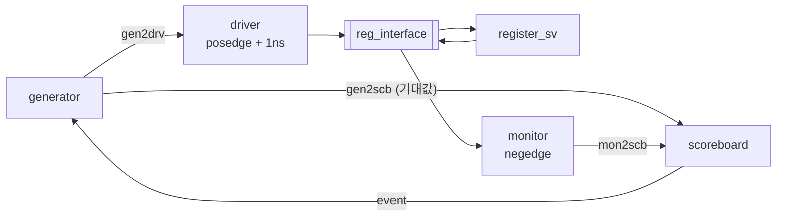

# register_sv — 32bit enable 레지스터의 SystemVerilog 검증 환경 + fork / join

> 📅 2026-08-19 ~ 20 · Vivado 2020.2 · SystemVerilog · 과제 12-1, 12-2

[adder_sv](../adder_sv)에서 만든 클래스 기반 검증 환경을 **clk이 있는 순차 회로**(32bit enable 레지스터)에 적용.
조합회로와 달리 **입력이 다음 clk에 출력으로 나오므로** drive · monitor 시점과 scoreboard의 비교 대상을 1clk 어긋나게 맞추는 것이 핵심.
함께 `fork ~ join` 계열의 동작 차이를 `tb_fork_join`으로 실험.

## 파일 구조

```
register_sv/
├── src/register_sv.sv        # always_ff, enable일 때만 q <= d
└── tb/
    ├── tb_register_sv.sv     # interface + gen / drv / mon / scb / env
    └── tb_fork_join.sv       # join / join_any / join_none / disable fork 실험
```

---

## DUT

```systemverilog
always_ff @(posedge clk, posedge reset) begin
    if (reset)       q <= 0;
    else if (enable) q <= d;
end
```

## 검증 환경



| 컴포넌트 | 타이밍 / 역할 |
|---|---|
| driver `preset()` | reset을 2clk 동안 걸고 해제 |
| driver `run()` | `@(posedge clk); #1;` 후 drive → 다음 posedge에 DUT가 샘플 |
| monitor | `@(negedge clk)`에서 `enable`, `d`, `q` 샘플 → 값이 안정된 시점 |
| scoreboard | **이전 transaction의 `d`** 와 현재 `q` 비교 |
| generator | 같은 값을 driver용 / scoreboard용 두 transaction에 복사해 각각 mailbox로 |

### 과제 12-1: drive · monitor 시점 문제

- **As-Is**: drive와 monitor가 같은 시점 → posedge+1ns에 넣은 `d`는 **다음 posedge**에야 `q`에 반영되는데 그 전에 `tr.d == tr.q`를 비교해 전부 FAIL
- **To-Be**: drive는 posedge+1ns, monitor는 negedge, 비교는 **1clk 전의 `d`(enable이었을 때) vs 현재 `q`**

```systemverilog
// scoreboard
mon2scb_mbox.get(tr);               // 현재 q
if (first_flag) begin
    if (tr_prev.enable) begin       // 이전 clk에 enable이었으면
        if (tr_prev.d == tr.q) pass_cnt++;
        else                   fail_cnt++;
    end
end else first_flag = 1;
gen2scb_mbox.get(tr_prev);          // 다음 비교에 쓸 기대값
->event2_gen;
```

- 첫 번째 샘플은 비교할 이전 값이 없으므로 건너뜀 (`first_flag`)
- 이전 시도: `d_prev` 변수 / queue(`prev_data[$]`)로 이전 값을 들고 다니는 방식 (주석으로 남김)

## 과제 12-2: fork / join 실험

```systemverilog
fork
    #10 A_thread();
    #20 B_thread();
    #15 C_thread();
join          // 또는 join_any / join_none
```

| 형태 | 결과 |
|---|---|
| `join` | 가장 늦은 B(20ns)까지 끝난 뒤 다음 줄 |
| `join_any` | 가장 빠른 A(10ns)가 끝나면 다음 줄, 나머지는 계속 실행 |
| `join_none` | 즉시 다음 줄, 스레드들은 백그라운드 실행 |
| 중첩 `fork` | 안쪽 `fork ~ join` 전체가 바깥에서 하나의 스레드로 취급 |
| `disable fork` | 아직 살아 있는 자식 스레드를 모두 종료 (`forever` 스레드 정리용) |

---

## 배운 내용

- **순차 회로 검증의 핵심은 시점**: drive(엣지 직후) → DUT 샘플(다음 엣지) → monitor(값이 안정된 반 clk 뒤) → 비교 대상은 1clk 전 입력
- 기대값을 generator에서 바로 scoreboard로 보내는 경로(gen2scb)를 두면 monitor가 입력을 다시 해석할 필요가 없음 → UVM의 reference model 개념
- `always_ff` / `always_comb`로 의도를 명시하면 툴이 잘못된 사용(예: always_comb에 래치)을 경고해 줌
- `forever` 컴포넌트는 `join_any` 이후에도 살아 있으므로 마무리 단계에서 `disable fork`나 `$finish`로 정리
