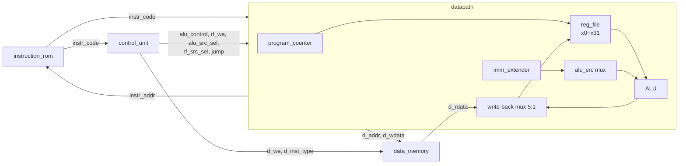

# rv32i_cpu_single_cycle — RISC-V RV32I 싱글 사이클 CPU

> 📅 2026-09-02 ~ 10 · SystemVerilog · Synopsys VCS / Verdi · 과제 15 ~ 16

RISC-V 명세서를 읽고 **RV32I 정수 명령어**(R / I / IL / S / B / U / J / JALR)를 1클럭에 1명령씩 실행하는 **싱글 사이클 하버드 구조 CPU**를 설계.
명령어 ROM은 C 코드를 컴파일한 기계어(`.mem`)를 `$readmemh`로 읽어 들이고, control unit · datapath · data memory를 직접 작성함.
(이후 multi-cycle, APB 버스 + 주변장치를 붙인 팀 프로젝트로 확장)

## 파일 구조

```
rv32i_cpu_single_cycle/
├── rtl/
│   ├── rv32i_cpu.sv        # rv32i_top(ROM + CPU + RAM), rv32i_cpu(CU + datapath)
│   ├── control_unit.sv     # opcode / funct3 / funct7 → 제어 신호
│   ├── datapath.sv         # reg_file, alu(+branch 비교), imm_extender, program_counter, mux
│   ├── instruction_rom.sv  # $readmemh("rom_code_ex1.mem")
│   ├── data_memory.sv      # byte addressing, SB/SH/SW, LB/LH/LW/LBU/LHU
│   ├── define.svh          # ALU / branch 제어 코드 `define
│   ├── pkg/rv32i_pkg.sv    # opcode_e, rv32i_instr_e enum (파형에서 이름으로 보기 위함)
│   └── rom_code_ex1.mem    # 테스트 프로그램 기계어
└── tb/tb_rv32i.sv          # clk / rst_n, fsdb dump
```

---

## 구조



- **하버드 구조**: 명령어 메모리(ROM)와 데이터 메모리(RAM)가 분리
- **싱글 사이클**: 명령어 하나를 1clk에 fetch → decode → execute → memory → write-back 모두 처리
- top에서 `.*` 암시적 포트 연결 사용

## 명령어 형식과 제어

| 타입 | opcode | 예 | ALU 입력 | write-back (`rf_src_sel`) | PC |
|---|---|---|---|---|---|
| R | `0110011` | add, sub, sll, slt, sltu, xor, srl, sra, or, and | rs1, rs2 | ALU (0) | +4 |
| I | `0010011` | addi, slti, xori, ori, andi, slli, srli, srai | rs1, imm | ALU (0) | +4 |
| IL | `0000011` | lb, lh, lw, lbu, lhu | rs1 + imm (주소) | RAM (1) | +4 |
| S | `0100011` | sb, sh, sw | rs1 + imm (주소) | — (`d_we = 1`) | +4 |
| B | `1100011` | beq, bne, blt, bge, bltu, bgeu | rs1 vs rs2 비교 | — | taken ? pc + imm : +4 |
| U (LUI) | `0110111` | lui | — | imm (2) | +4 |
| U (AUIPC) | `0010111` | auipc | — | pc + imm (3) | +4 |
| J | `1101111` | jal | — | pc + 4 (4) | pc + imm |
| JALR | `1100111` | jalr | rs1 + imm | pc + 4 (4) | rs1 + imm |

```systemverilog
// R type: ALU 연산 = {funct7[5], funct3}
OP_RTYPE: begin
    rf_we       = 1'b1;
    alu_control = {instr_code[30], funct3};
end
// I type: srai만 funct7[5]로 구분
OP_ITYPE: begin
    rf_we = 1'b1; alu_src_sel = 1'b1;
    alu_control = {(funct3 == 3'b101) ? instr_code[30] : 1'b0, funct3};
end
```

### imm_extender — 타입별 즉치값 조립 (항상 부호 확장)

| 타입 | 비트 배치 |
|---|---|
| I / IL / JALR | `{20{i[31]}, i[31:20]}` |
| S | `{20{i[31]}, i[31:25], i[11:7]}` |
| B | `{19{i[31]}, i[31], i[7], i[30:25], i[11:8], 1'b0}` |
| U | `{i[31:12], 12'b0}` |
| J | `{12{i[31]}, i[31], i[19:12], i[20], i[30:21], 1'b0}` |

- B / J의 마지막 비트는 항상 0 (2byte 정렬 주소)

### program_counter

```systemverilog
assign pc_srcsel = {1'b0, (b_taken & jump[0])} | jump[2:1];   // 0: +4, 1: pc+imm, 2: rs1+imm
always_ff @(posedge clk)
    if (!rst_n) register_pc <= 0;
    else        register_pc <= pc_next;
```

- B 타입은 ALU 옆의 **비교기(`b_taken`)** 가 참일 때만 분기
- `jump`를 one-hot으로 두어 B / JAL / JALR 경로를 구분

### reg_file / memory

- `x0`는 항상 0을 읽도록 처리 (`(ra == 0) ? 0 : rf[ra]`)
- ROM은 word 단위 배열이므로 `instr_rom[instr_addr[31:2]]`로 byte 주소 → word 인덱스 변환
- RAM은 **byte addressing, little endian**. `d_inst_type`(funct3)으로 SB / SH / SW 쓰기, LB / LH(부호 확장) / LBU / LHU(0 확장) 읽기 구분

## 테스트 프로그램 (`rom_code_ex1.mem`)

C 코드를 RV32I로 컴파일한 기계어 31줄. 스택 프레임 생성(`addi sp, sp, -32`, `sw ra / s0`), 지역 변수 load / store, 반복문(`bge`), **함수 호출 / 복귀(`jal` / `jalr`)** 가 포함되어 있어 S · IL · B · J · JALR 경로를 한 번에 확인할 수 있음.

```systemverilog
initial $readmemh("./rtl/rom_code_ex1.mem", instr_rom, 0, 31);
```

```bash
vcs -full64 -sverilog -debug_access+all -kdb rtl/pkg/rv32i_pkg.sv rtl/*.sv tb/tb_rv32i.sv -l comp.log
./simv -l sim.log
verdi -ssf wave.fsdb &
```

- control unit에서 opcode / 명령어를 `opcode_e`, `rv32i_instr_e` enum으로 캐스팅해 두어 Verdi 파형에서 `ADD`, `BEQ`처럼 **이름으로** 확인 가능

> 참고: I 타입 shift의 shamt 처리 조건(`instr_code[6:0] == (3'b101 || 3'b001)`)은 의도대로 funct3를 비교하지 않아 항상 `instr_code[31:20]`를 즉치값으로 사용합니다. `srai`처럼 상위 비트(funct7)에 값이 있는 경우 shift 양이 달라질 수 있어 확인이 필요합니다.

---

## 배운 내용

### Dedicated CPU → General purpose CPU

- 0~10 누적합처럼 한 알고리즘만 하는 **dedicated CPU**(FSM + 전용 레지스터)를 먼저 만들고,
  레지스터를 **범용 register file**로 바꿔 명령어로 동작을 지정하는 구조로 발전
- 싱글 사이클은 단순하지만 가장 느린 명령어(load)가 clk 주기를 결정 → multi-cycle → pipeline으로 개선

### RISC-V 명세서 읽기

- **ratified**(확정) 버전만 참고, `must` / `have to` / `use to` 구분, 작은 글씨와 주석 주의
- RV**32**I: 레지스터 폭 32bit, 명령어 고정 길이 32bit, 레지스터 32개(주소 5bit), 메모리는 **byte address**
- 어셈블리에서는 ABI 이름(`zero`, `ra`, `sp`, `t0`, `s0`, `a0` ...), 하드웨어에서는 `x0`~`x31` 주소
- privileged spec: U / S / M mode, CSR(`mstatus`, `mtvec`, `mepc`, `mcause`), trap 처리 순서

### Endian

| | 0번지에 | 장점 |
|---|---|---|
| Big endian | MSB | 부호·크기를 먼저 알 수 있음 (네트워크) |
| Little endian | LSB | 하위 바이트부터 연산(덧셈)에 유리 — RISC-V |

### 메모리 배치 (linker)

- text(코드, ROM) / data(초기화된 전역) / bss(초기화 안 된 전역) / heap(동적 할당, 위로) / stack(지역 변수·복귀 주소, 아래로)
- 펌웨어를 만들 때 이 배치를 정하지 않으면 memory access violation이나 값 오염이 생김
