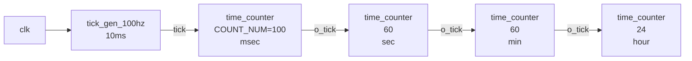
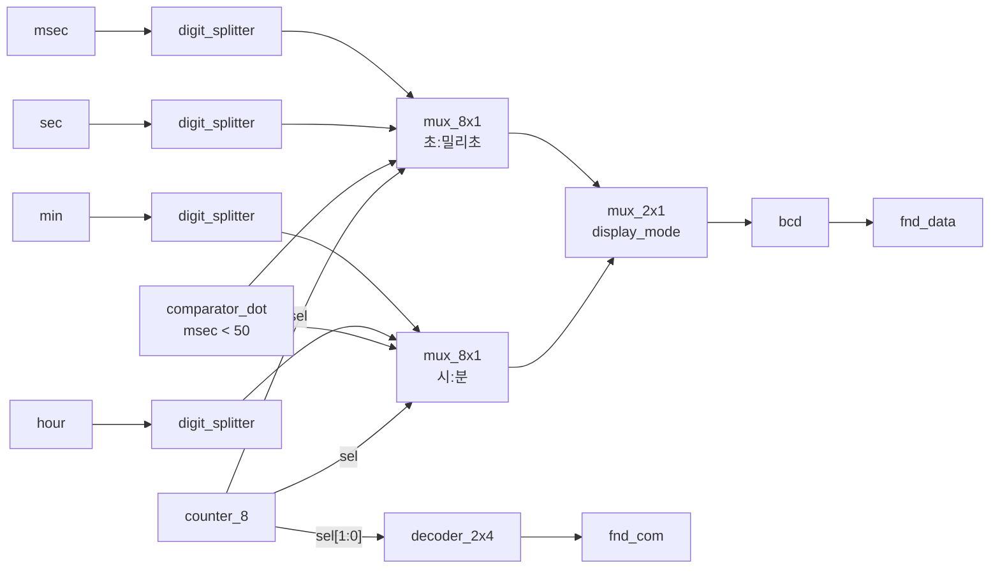

# stopwatch — 시:분:초:1/100초 스톱워치 datapath + 8자리 FND 컨트롤러

> 📅 2026-07-28 · 보드: Basys3 · Vivado 2020.2 · 프로젝트 1 준비 단계

[counter_updown](../counter_updown)의 구조(디바운서 → control unit → datapath → fnd_controller)를 그대로 가져와
10000진 카운터 자리에 **시 / 분 / 초 / 1/100초 카운터 체인**을 넣은 스톱워치.
같은 카운터 모듈을 `parameter`만 바꿔 4번 재사용하고, FND 컨트롤러는 **초:밀리초 / 시:분 화면 전환**과 **0.5초 점멸 dot**을 지원하도록 확장함.
(이 폴더는 datapath · FND 단까지 작성한 중간 버전. top 연결과 시계 기능을 합친 완성본은 [UART_stopwatch](../UART_stopwatch))

## 파일 구조

```
stopwatch/
├── src/
│   ├── stopwatch.v        # stopwatch_datapath, time_counter, tick_gen_100hz
│   ├── fnd_controller.v   # 8입력 MUX × 2 + 화면 전환 MUX, dot comparator
│   ├── control_unit.v     # [counter_updown]과 동일 (STOP/RUN/CLEAR/MODE)
│   └── btn_debouncer.v
├── tb/tb_stopwatch.v      # tb_tick_gen_100hz, tb_time_counter, tb_stopwatch
└── create_project.tcl     # Vivado 프로젝트 생성 스크립트
```

---

## 구조



| 카운터 | `COUNT_NUM` | 비트 수 (`$clog2`) |
|---|---|---|
| msec (1/100초) | 100 | 7 |
| sec | 60 | 6 |
| min | 60 | 6 |
| hour | 24 | 5 |

### time_counter — parameter로 재사용

```verilog
module time_counter #(parameter COUNT_NUM = 100) (
    ...
    output reg [$clog2(COUNT_NUM)-1:0] time_cnt,
    output reg o_tick                         // 자리올림(내림) 시 다음 단으로 1clk tick
);
    always @(posedge clk, posedge reset) begin
        if (reset | clear) begin
            time_cnt <= 0;
            o_tick   <= 1'b0;
        end else if (i_tick & run_stop) begin
            if (mode == 0) begin                       // up
                if (time_cnt == COUNT_NUM - 1) begin
                    time_cnt <= 0;            o_tick <= 1'b1;
                end else begin
                    time_cnt <= time_cnt + 1; o_tick <= 1'b0;
                end
            end else begin                             // down
                if (time_cnt == 0) begin
                    time_cnt <= COUNT_NUM - 1; o_tick <= 1'b1;
                end else begin
                    time_cnt <= time_cnt - 1;  o_tick <= 1'b0;
                end
            end
        end else begin
            o_tick <= 1'b0;                            // tick은 항상 1clk만
        end
    end
endmodule
```

```verilog
time_counter #(.COUNT_NUM(60)) U_COUNTER_SEC ( ... );   // 인스턴스마다 parameter override
```

#### 트러블슈팅

- **As-Is**: 처음엔 `o_tick <= 0`을 `if (i_tick)` 안에서만 처리 → 자리올림 tick이 1로 남아서 sec · min · hour가 **매 clk마다 증가**
- **To-Be**: `i_tick`이 없을 때도 `else`에서 `o_tick <= 0` → msec 99 → 0 다음 clk에 sec가 딱 1번만 증가

### fnd_controller — 8자리 선택 + 화면 전환



- `digit_splitter`를 `BIT_WIDTH` parameter로 바꿔 msec(7bit) · sec(6bit) · hour(5bit)에 모두 재사용, 1 / 10의 자리만 분리
- `counter_8`(0~7)의 하위 2bit는 자리 선택, 상위 bit는 숫자 / dot 출력 구간 선택에 사용
- `comparator_dot`: `msec < 50`이면 0 → 0.5초 주기로 dot 점멸 (LED는 0이 켜짐)
- `display_mode`(스위치)로 **초:밀리초 ↔ 시:분** 화면 선택 (`mux_2x1`)

## Simulation

| 테스트벤치 | 확인 |
|---|---|
| `tb_tick_gen_100hz` | 1,000,000 clk(10ms)마다 1clk tick |
| `tb_time_counter` | msec → sec → min 자리올림 연결 |
| `tb_stopwatch` | runstop = 1로 `stopwatch_datapath` 전체 동작 |

---

## 배운 내용

### FSM 2-stage 구조를 쓰는 이유

- next state / next output을 계산하는 **조합논리(CL)** 와, 상태·출력을 저장하는 **순차논리(SL)** 를 분리
- 한 `always`에 섞어 non-blocking으로 조합논리를 쓰면 실수가 많음
- 조합논리가 길어져 path가 길어지면 중간에 F/F를 끼워 **다음 clk으로 연산을 넘김** (pipeline 개념)

### parameter

```verilog
module stopwatch_datapath #(parameter MSEC_WIDTH = 7, SEC_WIDTH = 6, ...) ( ... );
time_counter #(.COUNT_NUM(100)) U_MSEC ( ... );    // 이름으로 override
comparator_dot #(MSEC_WIDTH) U_COMP_DOT ( ... );   // 순서로 override
```

- 같은 모듈을 비트 폭 · 최대값만 바꿔 재사용 → 모듈 수가 줄고 수정 지점이 한 곳으로 모임

### Vivado 프로젝트를 Tcl로 생성

- `create_project.tcl`: `src/`, `tb/`, `constraints/`만 저장소에 두고 Vivado 프로젝트 파일은 스크립트로 다시 만듦
